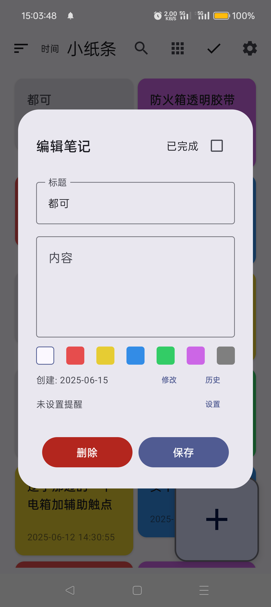
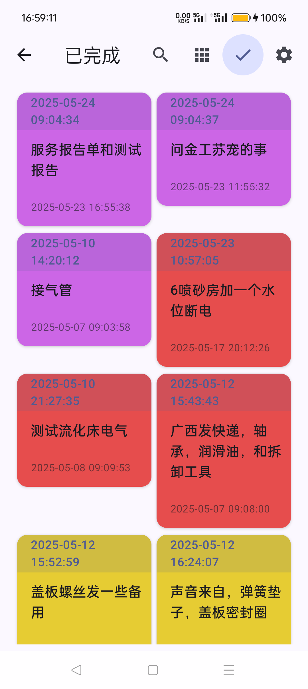
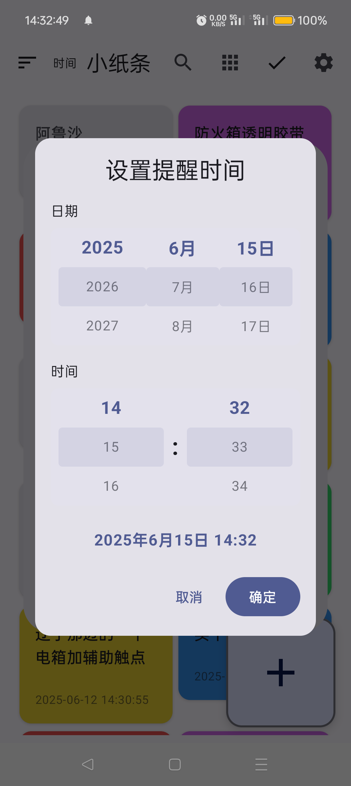

<div align="center">


# 小纸条 · XiaoZhiTiao

**一个用 Jetpack Compose 写的极简彩色便签应用**

七色分类 · 到期提醒 · 完成归档 · 编辑历史 · 回收站

[](https://github.com/qqmmxx/xiaozhitiao/releases/latest)


</div>

---

## 下载安装

**不想自己编译？直接装现成的：**

| | |
| --- | --- |
| 📦 **下载页** | [Releases · 所有版本](https://github.com/qqmmxx/xiaozhitiao/releases) |
| ⬇️ **最新版直链** | [`xiaozhitiao-v1.0.apk`](https://github.com/qqmmxx/xiaozhitiao/releases/download/v1.0/xiaozhitiao-v1.0.apk) |
| 📱 **环境要求** | Android 8.0（API 26）及以上 |
| 📏 **体积** | 10.4 MB |
| 🔑 **SHA-256** | `438190d90ff30e0c6072a272d21d0553c3c7f76b0fa8eab703ac531158a2df6b` |

安装时系统会提示「未知来源应用」或「Play 保护机制」，因为这是自签名 APK，允许安装即可。

> 校验下载完整性：
> ```bash
> # Windows
> certutil -hashfile xiaozhitiao-v1.0.apk SHA256
> # macOS / Linux
> shasum -a 256 xiaozhitiao-v1.0.apk
> ```

## 这是什么

「小纸条」把便利贴的物理直觉搬到了手机上：**颜色就是分类，贴纸就是待办**。

写一条笔记只需要敲标题和内容，然后挑一个颜色 —— 红色是急事，黄色要跟进，紫色是杂事，蓝绿随意。给纸条挂一个闹钟，到点它会主动提醒你；做完之后打勾，它就安静地归档到「已完成」里，不会被误删，也不会继续占着视线。

没有账号、没有云同步、没有信息流。所有数据都存在你手机的本地 Room 数据库里。

## 功能

| 功能 | 说明 |
| --- | --- |
| 🎨 **七色分类** | 白 / 红 / 黄 / 蓝 / 绿 / 紫 / 灰，一眼分辨优先级 |
| ⏰ **到期提醒** | 滚轮式日期时间选择器，到点推送通知并震动 |
| ✅ **完成归档** | 一键标记完成，自动移入「已完成」视图，可随时撤销 |
| 🔍 **即时搜索** | 标题与内容全文过滤 |
| 🗂 **网格 / 列表** | 两种浏览密度随时切换 |
| 🕘 **编辑历史** | 每条笔记的历次修改留痕，可回溯查看 |
| 🗑 **回收站** | 删除先入回收站，支持还原与彻底清除 |
| 🔠 **字号调节** | 全局正文字号可调，照顾不同视力 |
| 🔔 **开机自恢复** | 设备重启后自动重建闹钟，提醒不丢 |
| 📴 **纯本地** | 无网络权限，数据不出设备 |

## 界面

<div align="center">

| 编辑笔记 | 已完成 | 设置提醒 |
| :---: | :---: | :---: |
|  |  |  |

</div>

## 技术栈

- **语言**：Kotlin 2.0.21
- **UI**：Jetpack Compose + Material 3（BOM 2024.09.00）
- **持久化**：Room 2.6.1（含编辑历史表，外键关联笔记）
- **异步**：Kotlin Coroutines + StateFlow
- **提醒**：AlarmManager 精确闹钟 + BroadcastReceiver + 开机自恢复
- **构建**：AGP 8.9.2 / Gradle 8.11.1 / JDK 17 目标字节码

## 项目结构

```
app/src/main/java/com/xiaozhitiao/app/
├── MainActivity.kt              # Compose 入口、主界面与各对话框
├── data/
│   ├── NoteEntity.kt            # 笔记 / 编辑历史数据模型
│   ├── NoteDao.kt               # Room DAO
│   ├── NoteDatabase.kt          # 数据库定义与迁移
│   └── NoteRepository.kt        # 仓储层，向上屏蔽数据源细节
├── reminder/
│   ├── ReminderManager.kt       # 闹钟注册与取消
│   ├── ReminderReceiver.kt      # 广播接收，发通知 / 开机重注册
│   ├── ReminderUtil.kt          # 时间计算与格式化
│   └── ReminderDateTimePickerDialog.kt
└── ui/theme/                    # Material 3 主题、配色、字体
```

## 构建与运行

### 环境要求

- Android Studio Ladybug 及以上（或命令行 Gradle）
- JDK 17+
- Android SDK：`compileSdk 34`，最低运行 `minSdk 26`（Android 8.0）

### 从源码构建

```bash
git clone https://github.com/qqmmxx/xiaozhitiao.git
cd xiaozhitiao

# 首次需要指定本机 SDK 路径
echo "sdk.dir=/path/to/Android/Sdk" > local.properties

# 调试版
./gradlew assembleDebug

# 发布版（需要签名，见下）
./gradlew assembleRelease
```

产物位于 `app/build/outputs/apk/`。

### 配置发布签名

仓库不包含任何签名密钥。要构建自己的发布版，请在项目根目录新建 `keystore.properties`：

```properties
storeFile=keystore/your-release.jks
storePassword=你的密码
keyAlias=你的别名
keyPassword=你的密码
```

并生成对应密钥库：

```bash
keytool -genkeypair -v \
  -keystore keystore/your-release.jks \
  -alias your-alias \
  -keyalg RSA -keysize 2048 -validity 10950
```

`keystore.properties`、`*.jks`、`*.keystore` 均已在 `.gitignore` 中，不会被提交。

> 未配置签名时，`assembleRelease` 会自动回退到 debug 签名，仅用于本地验证，**不要用于分发**。

## 权限说明

| 权限 | 用途 |
| --- | --- |
| `POST_NOTIFICATIONS` | Android 13+ 发送提醒通知 |
| `SCHEDULE_EXACT_ALARM` / `USE_EXACT_ALARM` | 在指定时刻精确触发提醒 |
| `RECEIVE_BOOT_COMPLETED` | 设备重启后重建闹钟 |
| `VIBRATE` | 提醒时震动 |

应用**不申请网络权限**，不具备任何联网能力。

## 路线图

- [ ] 笔记拖拽排序
- [ ] 富文本 / Markdown 内容
- [ ] 桌面小组件
- [ ] 本地备份与恢复（导出 JSON）
- [ ] 深色主题手动切换

## 贡献

Issue 和 PR 都欢迎。提交前请确保 `./gradlew assembleDebug` 通过。

## 许可证

[MIT](LICENSE)
